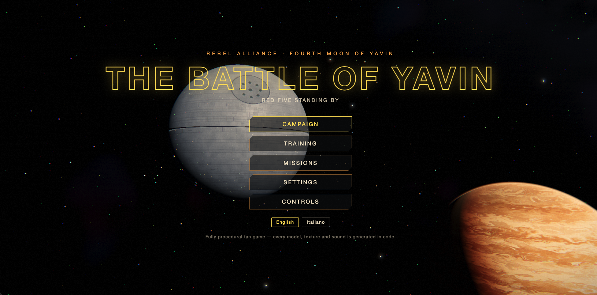
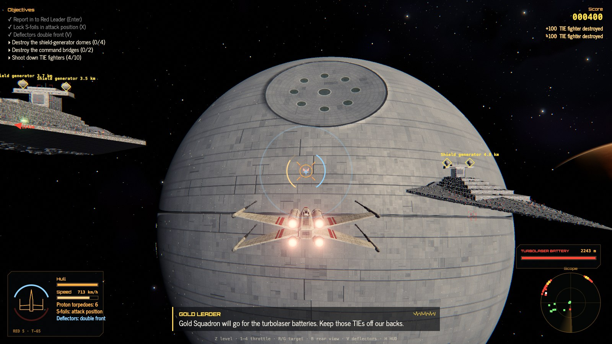
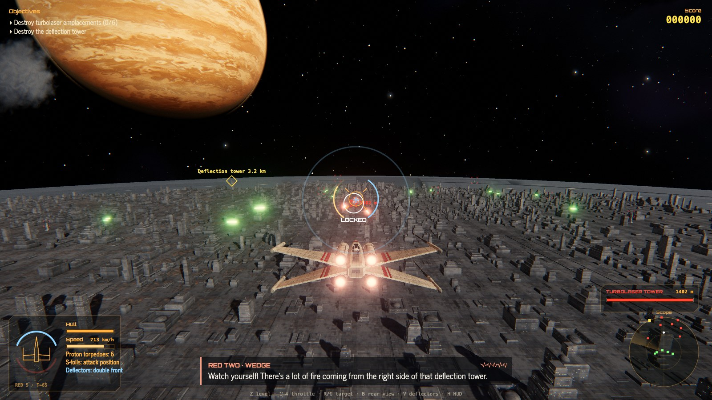
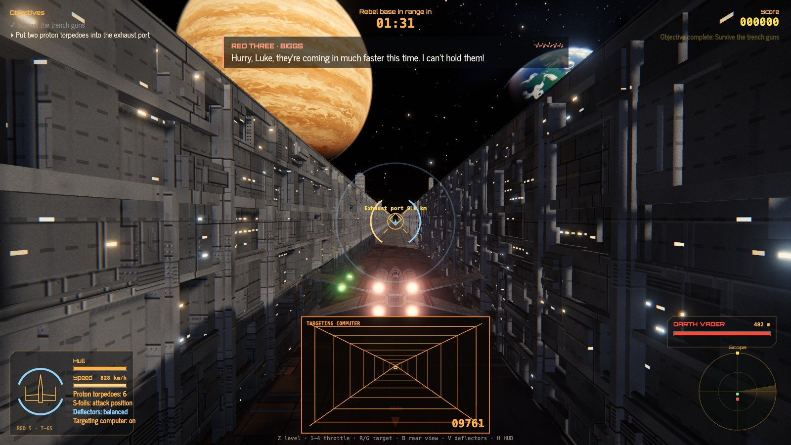

# The Battle of Yavin

> [!IMPORTANT]
> **Unofficial, free, non-commercial fan game.** Not affiliated with, endorsed, sponsored or approved by Lucasfilm Ltd. or The Walt Disney Company. *Star Wars* and all related names, characters and vehicles are trademarks and/or copyrights of Lucasfilm Ltd. / Disney, used here only for non-commercial fan purposes. Nothing here is for sale, ever. The code licence covers only our original source code and grants no rights in any Lucasfilm/Disney property.
> **Read [LEGAL.md](LEGAL.md) before copying, forking or distributing.**



> [!NOTE]
> **AI-assisted.** This project was built with heavy help from AI coding assistants. It is purely a personal exercise in style, made so I can play something I love. It is not a product, not a portfolio piece and not a commercial undertaking.

A browser-based 3D space-combat game that lets you fly Red Five through the Battle of Yavin from *Star Wars: Episode IV – A New Hope* (1977), from the briefing in the Massassi temple to the trench run. Built with Vite, TypeScript and three.js.

**Everything is procedural.** Every model, texture, shader, sound effect and music track is generated by code at runtime. The repository contains no images, audio, 3D models or logos from the films or any third party. The soundtrack is an original procedural score. The only bundled third-party assets are two open-source fonts under the SIL Open Font License: Orbitron (titles and HUD) and News Cycle (text, crawl and subtitles), installed via `@fontsource`.

## Screenshots

All captured in-engine (real-time, procedural assets).







## Features

- Full campaign plus free mission select, with cinematic briefing hologram and epilogue. In the Star Destroyer battle the TIEs scramble from under the hangar bays, at most eight in the air at once, until the hangar or the destroyer is knocked out.
- Free battle modes in orbit above Yavin, Tatooine (twin suns), Naboo, Alderaan, Coruscant, Hoth or Endor, all procedural: **Free battle** (choose arena, allies, TIE fighters and Star Destroyers), **Solo** (no wingmen), **Survival** (endless waves of rising difficulty, scored on the wave you reach) and **Random battle**.
- Arcade flight model with flight assists (auto-level, throttle presets), boost and evasive rolls, deflector shields, S-foils, targeting and a trench-run targeting computer.
- Cockpit-style HUD: fore and aft sensor scopes, targeting display with target silhouette, range, speed, closing rate and direction.
- Wingmen and enemy AI with radio chatter shown as subtitles, optionally spoken with the browser's built-in text-to-speech. Wingmen come to your aid when a TIE sits on your tail, and pursuers eventually overshoot.
- Four difficulty levels with scaled aim assist. A laser lock on the selected enemy fighter guides your shots: instant on Cadet, after a delay on Pilot and Ace, none on Jedi; it holds until the target leaves your view, you pick another target or you release it. On Cadet, TIE fighters are also slower and less agile than your X-wing.
- Keyboard + mouse and gamepad support.
- Bilingual **English / Italian**, with an i18n layer ready for more languages.

## Missions

| Mission | Summary |
|---|---|
| **Flight Training** | Holographic course off Yavin 4: rings, throttle, levelling assist, gunnery, torpedo locks and a live-fire duel. |
| **Briefing** | General Dodonna's hologram briefing in the Massassi temple war room. |
| **The Assault** | Red Squadron against the Imperial screen, including a non-canon battle against two Star Destroyers. |
| **Surface Attack** | Dive on the Death Star's surface, destroy turbolaser emplacements and the deflection tower, then hold off the TIEs. |
| **The Trench Run** | Skim the meridian trench to the thermal exhaust port while Darth Vader closes in. |
| **One in a Million** | Epilogue: escape before the reactor goes critical, then the medal ceremony. |

## Difficulty

| Level | Description |
|---|---|
| Cadet | Forgiving: enemies are slower to aim and you take half damage. |
| Pilot | The intended experience. |
| Ace | Sharper TIE pilots, denser waves, heavier fire. |
| Jedi | Ruthless. Every hit hurts. |

Aim assist (bolt magnetism, reticle friction, torpedo lock time) scales with difficulty and can be disabled in Settings.

## Controls

| Input | Action |
|---|---|
| Mouse | Virtual flight stick (pointer lock) |
| Left click / Space | Fire lasers |
| W / S (Ctrl) | Throttle up / down |
| 1 – 4 | Throttle presets |
| A / D or Q / E | Roll |
| Shift (hold) | Boost |
| Double-tap A / D or Q / E | Evasive barrel roll (most bolts miss) |
| Arrow keys | Pitch / yaw |
| Z | Auto-level (wings level, nose to horizon) |
| X | S-foils open / closed |
| V | Deflector shields |
| R | Next target |
| G | Target whoever is shooting you |
| L | Release / restore the laser lock on the target |
| F | Proton torpedo (hold the target to lock) |
| T | Targeting computer |
| B (hold) | Rear view |
| C | Cockpit / chase camera |
| H | Toggle HUD |
| N | Skip training exercise |
| Enter (hold) | Skip cinematic |
| Esc / P | Pause |

A standard gamepad is supported (A skips cinematics, D-pad down looks back).

## Run and build

Requires [Bun](https://bun.sh) (or Node.js with npm).

```bash
bun install
bun run dev        # development server
bun run build      # tsc --noEmit + vite build → dist/
bun run preview    # serve the production build
```

With npm: `npm install`, `npm run dev`, `npm run build`.

## How it works

- **Rendering**: three.js scene graph; ships, the Death Star surface, the trench, Star Destroyers and the Yavin system are assembled from code-generated geometry (`src/models`, `src/world`).
- **Textures**: painted at runtime onto canvases (panelling, greebles, surface detail) and uploaded as GPU textures; nothing is loaded from disk.
- **Audio**: Web Audio synthesis for lasers, engines, explosions and an original adaptive score (`src/audio`). Voices use the browser's speech synthesis.
- **Determinism**: a seeded RNG (`src/core/rng.ts`) keeps generated content stable between runs.

## Project structure

```
src/
  core/    engine loop, input (mouse/keyboard/gamepad), settings, seeded RNG
  game/    game state, ships, AI, weapons, capital ships, towers, FX, comms, mission scripting
  levels/  briefing, training, missions (assault, surface, trench), epilogue, shared environments
  models/  procedural ship models and textures
  world/   procedural celestial bodies, Death Star surface and trench, mesh builders
  audio/   procedural sound effects and music
  ui/      HUD and menus
  i18n/    dictionaries (en.ts, it.ts) and translation helpers (i18n.ts)
  main.ts  entry point
```

## Adding a language

1. Copy `src/i18n/it.ts` to e.g. `src/i18n/fr.ts`, rename the export, and translate every value. The object must be typed as `Dictionary`: TypeScript enforces the exact key set defined by `src/i18n/en.ts`, so a missing or misspelled key fails the build.
2. Register it in `LANGS` in `src/i18n/i18n.ts`:
   ```ts
   { id: 'fr', label: 'Français', speech: 'fr-FR', dict: fr },
   ```
   `speech` is the BCP 47 tag used for browser text-to-speech.
3. Run `bun run build` to type-check.

## Credits and legal

- Created by The Battle of Yavin contributors as a non-commercial tribute.
- Inspired by *Star Wars: Episode IV – A New Hope* (1977), written and directed by George Lucas. *Star Wars* © & ™ Lucasfilm Ltd. All rights reserved by their owners. A few short dialogue lines in the subtitles are quoted or paraphrased from the film and credited to it; they will be removed on request.
- Built with [three.js](https://threejs.org) (MIT), [Vite](https://vite.dev) (MIT) and [TypeScript](https://www.typescriptlang.org) (Apache-2.0). Fonts: [Orbitron](https://github.com/theleagueof/orbitron) and [News Cycle](https://github.com/googlefonts/NewsCycle) (SIL Open Font License 1.1).
- Source code: [PolyForm Noncommercial 1.0.0](LICENSE): **non-commercial use only**, and it does not license any Lucasfilm/Disney property. See [LEGAL.md](LEGAL.md) for the full notice, the no-monetisation rules and the rights-holder takedown policy.
